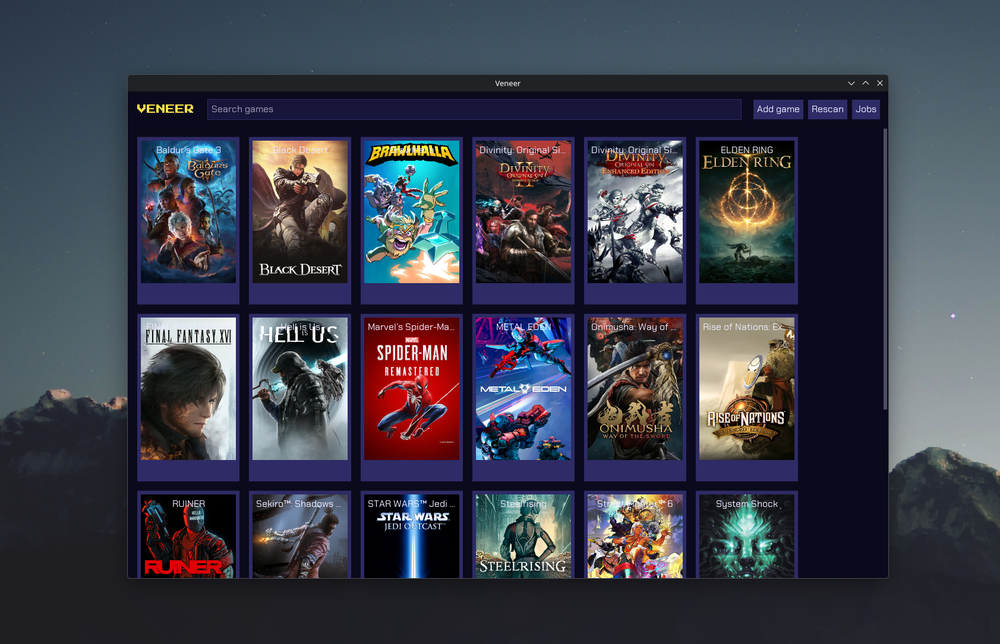

# Veneer

A Linux-native game launcher. Veneer runs your Steam library and the games
you add yourself through Proton, Wine or natively, with gamescope and
[OptiScaler](https://github.com/optiscaler/OptiScaler) one click away. It
never touches game files: what it adds is layered over the game at launch
and gone when the game exits.



**Status: pre-alpha.** See [docs/plan.md](docs/plan.md#status) for what has
been verified on real games.

**Guides: <https://benehiko.github.io/veneer/>**, rendered from
[docs/guides/](docs/guides/README.md).

## Develop

```sh
nix develop   # Zig, make, pandoc and pagefind
make hooks    # once per clone: zig fmt check and tests before each commit
make build    # zig-out/bin/veneer
make test     # unit tests
make install  # under ~/.local (PREFIX=...)
make site     # the website, into _site/; make serve to preview it
```

[docs/architecture.md](docs/architecture.md) explains the code and the
release; [AGENTS.md](AGENTS.md) holds the rules for contributors, human or
agent, and [CONTRIBUTING.md](CONTRIBUTING.md) explains how to send a change.

## License

[GPL-3.0-or-later](LICENSE). No warranty.
