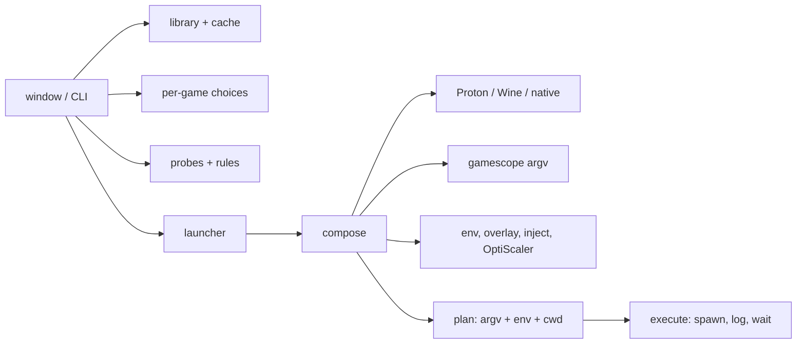

# Architecture

Repository rules live in [AGENTS.md](../AGENTS.md); the roadmap in
[plan.md](plan.md).

## One binary

`veneer` is one native Linux executable, written in Zig 0.17. With no
arguments it opens the window; with a command it runs headless, so every
feature can be tested and scripted without the GUI (`veneer help`).

The build also produces `veneer-inject.exe`, a Windows PE that runs inside
Proton or Wine to start a game suspended and load DLLs into it. It is the
only code that runs under Wine.

`compose` gathers what a launch needs from the system (Proton builds,
gamescope's flags, the screen size, staged files). `plan.build` turns that
into argv, environment and working directory. It is pure and carries most
of the launch tests. `execute` spawns the result and logs it.
`--dry-run` stops after `plan.build` and writes nothing.

## Layout

| Path | What |
| --- | --- |
| `src/main.zig`, `src/cli.zig`, `src/commands.zig` | entry point, argument parsing, one function per command |
| `src/paths.zig` | XDG directories |
| `src/library/vdf.zig` | text VDF/ACF parser |
| `src/library/appinfo.zig` | Steam's binary `appcache/appinfo.vdf` (v27–v29): names, app types, launch entries |
| `src/library/steam.zig` | Steam roots, `libraryfolders.vdf`, app manifests, compat-tool mapping, cover art |
| `src/library/manual.zig` | games the player adds, in `library.zon` |
| `src/library/cache.zig` | the last scan, so the window opens at once |
| `src/runner/proton.zig` | Proton discovery and Steam's tool aliases |
| `src/runner/ge_proton.zig` | GE-Proton download, digest check and safe unpacking of `.tar.gz` and `.tar.zst` |
| `src/runner/steam_install.zig` | following an install Steam runs, through its app manifest |
| `src/runner/translators.zig` | DXVK and VKD3D-Proton in Veneer's own Wine prefixes |
| `src/launch/steam_overlay.zig` | the variables that load Steam's overlay |
| `src/gui/theme.zig` | Adwaita with Inter |
| `src/config/` | per-game choices, global settings, the ZON file helper |
| `src/launch/` | `compose`, `plan`, `gamescope`, `display`, `steam_client`, `execute`, `launcher` |
| `src/hooks/overlay.zig` | the private overlay mount (`veneer __overlay`) |
| `src/hooks/optiscaler.zig` | staging an OptiScaler release into a game's overlay |
| `src/hooks/anticheat.zig` | EasyAntiCheat and BattlEye detection |
| `src/optiscaler/` | pinned releases, download and checksum, unpacking with the host's `bsdtar`, `7zz` or `7z` |
| `src/inject/` | `veneer-inject.exe` and the variables it reads |
| `src/compat/` | system probes (`facts`, `vulkan`) and the rule engine |
| `src/gui/` | the dvui window (`app.zig`) and its pure model (`model.zig`) |
| `data/compat.tsv` | compatibility rules, each with its source |
| `data/optiscaler.tsv` | OptiScaler releases Veneer will install, with their SHA-256 |
| `data/translators.tsv` | DXVK and VKD3D-Proton releases Veneer will install, with their SHA-256 |
| `data/veneer.desktop`, `data/veneer.svg` | the desktop entry and icon |

## Where Veneer keeps its files

Nothing goes in a game's install.

| Path | Holds |
| --- | --- |
| `$XDG_CONFIG_HOME/veneer/settings.zon` | global settings: the OptiScaler release folder |
| `$XDG_CONFIG_HOME/veneer/library.zon` | games added by hand |
| `$XDG_CONFIG_HOME/veneer/games/<id>.zon` | each game's choices |
| `$XDG_DATA_HOME/veneer/prefixes/<id>` | Wine prefixes for games Steam does not own |
| `$XDG_DATA_HOME/veneer/translators/<name>-<tag>` | unpacked DXVK and VKD3D-Proton releases |
| `$XDG_DATA_HOME/veneer/overlay/<id>/{upper,work}` | each game's overlay layer |
| `$XDG_CACHE_HOME/veneer/library.zon` | the last library scan |
| `$XDG_STATE_HOME/veneer/logs/<id>.log` | the last launch, and `.prev` before it |

Config files are ZON: `std.zon` reads and writes them, so they cost no
dependency.

## Library

- **Steam roots:** `~/.local/share/Steam`, `~/.steam/steam` and Flatpak's
  `~/.var/app/com.valvesoftware.Steam/data/Steam`. Each root's
  `steamapps/libraryfolders.vdf` lists its libraries; libraries named twice
  are scanned once.
- **Games:** every `appmanifest_*.acf` whose `StateFlags` has the installed
  bit. `appinfo.vdf` supplies the name, the app type (only games,
  applications, demos and betas are listed) and the launch entry for the
  platform, skipping beta-branch entries.
- **Platform:** an explicit compat-tool mapping means Windows (a Steam Linux
  Runtime mapping means Linux); otherwise a Linux entry in `oslist` means
  native; otherwise Windows.
- **Cover art:** `appcache/librarycache/<appid>/library_600x900.jpg`, then
  the older flat names, then `header.jpg`.
- **Added games:** the executable's header decides the platform (`MZ` is
  Windows; ELF or `#!` is Linux). The id is a hash of the path.

## Runners

| Choice | Meaning |
| --- | --- |
| `auto` | Steam's mapping for the app (`CompatToolMapping` in `config/config.vdf`), then the global default, then the newest official numbered Proton; Linux games run natively |
| a Proton name | a directory name or internal name from `compatibilitytools.d`, `/usr/share/steam/compatibilitytools.d` or any library's `steamapps/common` |
| `native` | Linux games only; Steam games run through the scout runtime's `run.sh` when present |
| a path to `wine` | Wine with a prefix of the game's own |

Steam games run as Steam runs them: the `proton` script with
`waitforexitandrun` and the `STEAM_COMPAT_*` variables, in the game's own
`compatdata` prefix. Veneer also sets what Steam sets for its overlay:
both `gameoverlayrenderer.so` builds in `LD_PRELOAD` (after any the player
already has), `SteamOverlayGameId`, and
`ENABLE_VK_LAYER_VALVE_steam_overlay_1=1` for Steam's Vulkan overlay layer. Games Steam does not own get a prefix under
`$XDG_DATA_HOME/veneer/prefixes`. Steam games need the client for their DRM,
so Veneer starts `steam -silent` first if `~/.steam/steam.pid` names no
running Steam. `veneer install-proton` and the window's button send
`steam://install/1493710` (Proton Experimental) to Steam, then follow the
install every two seconds through `appmanifest_1493710.acf` in any
library: `BytesDownloaded` of `BytesToDownload` while it downloads,
`BytesStaged` of `BytesToStage` while it installs, and paused while
`StateFlags` has the update-paused bit (512). The install is done when
`StateFlags` has the installed bit (4) and none of update-required (2),
update-running (256), update-paused (512) or update-started (1024). The
window then rescans; if no manifest appears within five minutes, Veneer
says so and stops following.

### Custom Wine

A game whose runner is a path to `wine` gets a prefix under
`$XDG_DATA_HOME/veneer/prefixes`. Plain Wine draws DirectX through WineD3D,
so before the first launch Veneer:

1. downloads the DXVK and VKD3D-Proton releases pinned in
   `data/translators.tsv`, checks each against its SHA-256, and unpacks it
   (`std.compress.flate` or `std.compress.zstd`, then `std.tar`, with the
   same refusals as GE-Proton) into `$XDG_DATA_HOME/veneer/translators`;
2. creates the prefix with `wine wineboot --init`, with Mono and Gecko
   turned off (`WINEDLLOVERRIDES=mscoree,mshtml=`);
3. copies the 64-bit DLLs into `system32` and the 32-bit ones into
   `syswow64`, or the 32-bit ones into `system32` in a 32-bit prefix;
4. writes `.veneer-translators` in the prefix, naming the releases, so later
   launches skip steps 2 and 3 until the pins change.

Each launch then sets `WINEDLLOVERRIDES` to every copied DLL as native,
then builtin (`d3d10core,d3d11,d3d12,d3d12core,d3d8,d3d9,dxgi=n,b`). If
any step fails, Veneer warns and launches anyway. Proton needs none of
this: it ships both.

`veneer install-proton ge` and the Runner menu's **Download GE-Proton**
ask GitHub's API for the latest GE-Proton release, pick the build for this
CPU, download it, and check it against the SHA-256 digest GitHub publishes;
a release without a digest is refused. Veneer unpacks the `.tar.gz` itself
(`std.compress.flate` and `std.tar`), refusing entries that climb out,
symlinks that point outside the build, and writes through a symlink, then
renames the build into Steam's `compatibilitytools.d`.

## gamescope

Two choices reach gamescope: **Display** (normal or gamescope fullscreen)
and **Upscaling** (FSR 1 or NIS, with a render scale of 100, 77, 67, 59 or
50 %). FSR and NIS imply gamescope. The output size is the largest connected
mode in `/sys/class/drm/*/modes`, overridable with `--size`. Veneer reads
`gamescope --help` once: builds with `--filter` get `-F fsr|nis`, older ones
get `-U` or `-Y`, and `--hdr-enabled` is passed only when offered.

## Hooks without touching the game

### Environment

Variables only: the player's own (`env=` settings), and one
`WINEDLLOVERRIDES` naming every DLL that must load native first:
OptiScaler's `dxgi`, and DXVK's and VKD3D-Proton's in a custom Wine
prefix. The player's value wins.

### Overlay

`veneer __overlay <lower> <upper> <work> <cwd> -- <argv>` wraps the whole
launch, gamescope included:

1. `unshare(CLONE_NEWUSER | CLONE_NEWNS)`, then map the player's uid and gid
   onto themselves.
2. Make the mount tree private, and mount overlayfs (`userxattr`) on the
   game directory's own path: the install is the read-only lower layer,
   `$XDG_DATA_HOME/veneer/overlay/<id>/upper` the upper.
3. `chdir` into the working directory again, because the old handle still
   points below the mount, then exec the launch.

Only that process tree sees the merged directory. Steam, its updater and
its file check see the install unchanged. Files the game writes beside its
exe land in the upper layer and stay with the game.

This needs Linux 5.11 or later and unprivileged user namespaces; the compat
rules check both, and each refused step has its own error message.

### OptiScaler

OptiScaler's own `setup_linux.sh` renames `OptiScaler.dll` to `dxgi.dll`
beside the game's exe and asks for `WINEDLLOVERRIDES=dxgi=n,b`. Veneer does
the same in the overlay: it links every file of the chosen release into the
upper layer, under the name `dxgi.dll` for the DLL, and copies
`OptiScaler.ini` once so each game keeps its own edits. The release's setup
scripts and notes are left out. The target is the exe's directory, or, for
Unreal Engine games, `<Project>/Binaries/Win64` beside the `-Shipping.exe`.

The release comes from one of two places
([guide](guides/optiscaler.md)):

- a folder the player extracted (`veneer optiscaler <folder>`);
- `veneer optiscaler install [tag]`, which downloads a release pinned in
  `data/optiscaler.tsv` with `std.http.Client`, checks its SHA-256, lists it
  with the first of `bsdtar`, `7zz`, `7z` on `PATH` and refuses absolute or
  `..` paths, unpacks it into a temporary folder, refuses symlinks, and
  renames the folder to `$XDG_DATA_HOME/veneer/optiscaler/<tag>`. Veneer has
  no 7z code of its own.

### Injection

`veneer run <game> --inject <dll>` starts `veneer-inject.exe` in place of the
game. Proton or Wine runs it; it reads the game from `VENEER_GAME_EXE` and
`VENEER_GAME_ARGS`, and the DLLs from `VENEER_INJECT_DLLS` (Windows paths on
`Z:`), because environment variables cross Wine unmangled. It creates the
game suspended, loads each DLL with a remote `LoadLibraryW`, and resumes it.

### Anti-cheat

The overlay and injection refuse any game with EasyAntiCheat or BattlEye
files in its install or one directory down.

## Compatibility checks

| Probe | Source |
| --- | --- |
| Kernel | `uname` |
| GPU vendor and kernel driver | `/sys/class/drm/card*/device/{vendor,driver}` |
| Vulkan devices, their Vulkan version, driver name and version (Mesa or NVIDIA) | a Vulkan 1.1 instance through `libvulkan.so.1`, `VkPhysicalDeviceProperties.apiVersion`, `VkPhysicalDeviceDriverProperties` |
| ROCm | `/opt/rocm`, `/opt/rocm/.info/version` |
| User namespaces | `kernel.unprivileged_userns_clone`, `user.max_user_namespaces`, `kernel.apparmor_restrict_unprivileged_userns` |
| gamescope | `gamescope --help` |
| Display | `/sys/class/drm/*/modes` |

`data/compat.tsv` holds the rules: feature, check, operator, value,
severity, message, source URL. A test refuses a row without a source.
`rules.evaluate` keeps the rules for the features a launch uses and sorts
them worst first. The `wine` feature is in use whenever the game runs
through Proton or Wine; version checks on the Vulkan driver read the
discrete GPU, else the first one. `veneer doctor` prints every probe and every rule that
fires; `veneer run` and the window refuse to launch on an error unless the
player passes `--force`.

## The window

**Stack:** [dvui](https://github.com/david-vanderson/dvui), pinned in
`build.zig.zon`, on its `sdl3gpu` backend: SDL3, built from source, renders
through SDL's GPU API (Vulkan on Linux). FreeType draws text; `stb_image`
decodes cover art. The theme is dvui's Adwaita (light or dark, following the
system) with Inter as its font; Inter comes from its release zip, pinned in
`build.zig.zon`, and is embedded in the binary.

**Wayland first.** Veneer sets `SDL_HINT_VIDEO_DRIVER` to `wayland,x11`
before SDL starts, so it runs natively on Wayland and uses X11 only when no
Wayland compositor answers.

**Fast:**

- The loop sleeps in `waitEventTimeout` and draws only when an event,
  animation or worker asks for a frame, so an idle window costs no CPU.
- The window opens on the cached library and cover art. A worker thread
  rescans Steam, reads the art, finds Proton builds and probes the system,
  then swaps the result in.
- Launches run on worker threads and report back with toasts. Closing the
  window waits for the workers.

**Pages:** a grid of cards (cover art or a named placeholder) with search,
Add game and Rescan; and a game page with Play, the compatibility verdicts,
Runner, Display, Upscaling, render scale, HDR, and a collapsed Advanced
section (environment, game arguments, gamescope arguments). Choices save as
they change.

**Known limits of dvui:** text is laid out one glyph per code point, so
complex scripts (Arabic, Hebrew, ligatures) do not render correctly.

## Release

`zig build install` puts in place everything a package needs: `bin/veneer`,
`bin/veneer-inject.exe`, the desktop entry, the icon under
`share/icons/hicolor/scalable/apps`, and the licenses under
`share/licenses/veneer`.

`make release` refuses a dirty tree, then for each of `RELEASE_TARGETS`
(default `x86_64-linux-gnu`) builds with `-Doptimize=safe` and the version
from `git describe`, and packs the install into
`dist/veneer-<version>-<arch>-linux.tar.gz` with sorted names, owner 0 and
the last commit's time, so the same commit gives the same bytes. It writes
`dist/SHA256SUMS` and signs each tarball and the sums with
`gpg --detach-sign --armor` (`GPG_KEY` picks the key).

The flake's `packages.default` builds in two steps. `deps` is a
fixed-output derivation that runs
`zig build --pkg-dir $out -Doptimize=safe --help`. That runs the build
script, so it fetches dvui, SDL3, Inter and the lazy packages this build
asks for, ahead of the build. `--fetch=all` would also fetch lazy packages
Veneer never uses, and some of those carry broken hashes upstream. The package then copies them to a writable folder and builds with
`zig build --pkg-dir` pointing there; Nix's sandbox has no network, so
nothing more is fetched. (`--system` would not do: it also turns on every
system-library integration, and dvui then looks for SDL3 and FreeType on
the host instead of building them.) Then `autoPatchelfHook` adds every
library SDL and Veneer may open at run time: the Vulkan loader, libglvnd,
Wayland, libxkbcommon, libdecor, X11, DRM, udev, dbus, PipeWire,
PulseAudio, ALSA, fribidi, libthai, libusb and liburing. Steam's API,
sndio, JACK and `libGLES_CM` are left out. The package suits NixOS only:
Nix's Vulkan loader looks for drivers in `/run/opengl-driver`, and a host
driver such as Arch's `/usr/lib/libvulkan_radeon.so` cannot load its own
libraries under Nix's dynamic loader, so SDL finds no GPU backend. Wrapping
Veneer in `nixGL` would fix the window, but its `LD_LIBRARY_PATH` and
Vulkan variables would pass on to every game Veneer starts, and
`veneer doctor` would report Nix's Mesa, not the host's. When
`build.zig.zon` changes, `depsHash` in `flake.nix` must change too: set it
to `lib.fakeHash`, run `nix build`, and copy the hash Nix reports.
